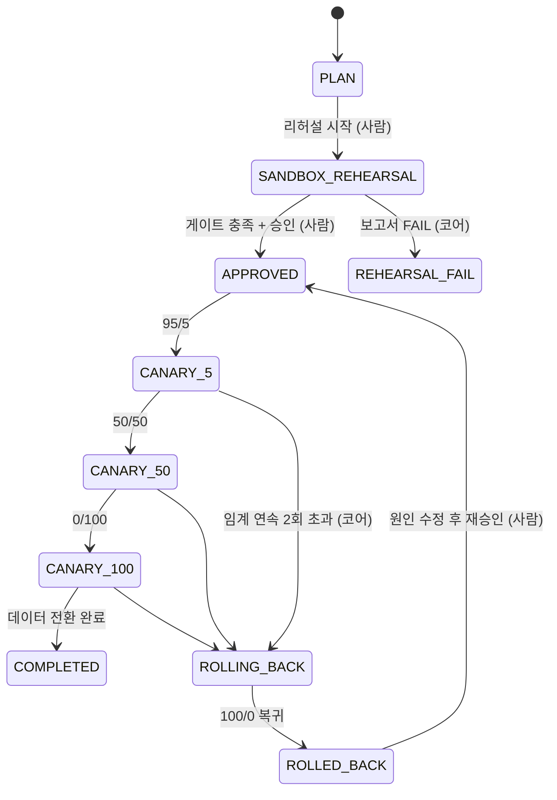

# 🏹 Hunter by Team Hunter

**AWS ECS → GCP Cloud Run, 데이터·파일까지 같은 주소로 무중단 이관하는 멀티클라우드 관제 플랫폼**

2026 SoftBank Hackathon 2차 · Team Hunter

[🎬 데모 영상]() · [🌐 라이브 서비스](https://sbhunter.site/) · [📑 발표 자료](https://app.notion.com/p/40b8bee9ada480f5a418e5f4fbc52268)

---

## 💡 왜 만들었나

새 클라우드에 앱을 올리는 일은 어렵지 않다. 어려운 것은 세 가지 판단이다. 데이터가 빠짐없이 옮겨졌는가, 새 환경이 같은 업무 결과를 내는가, 실패하면 어디까지 되돌릴 수 있는가. 운영자는 이 판단을 위해 양쪽 클라우드 콘솔과 DB를 오가며 상태를 직접 맞춰 봐야 했다.

**Hunter**는 이관 한 건을 **상태 기계로 관리하는 이전 작업(Run)** 으로 묶는다. AI가 샌드박스에서 먼저 연습하고 보고서를 내면 사람이 근거를 보고 승인하고 관제 코어가 트래픽을 5→50→100%로 넘기며 지표가 나빠지면 스스로 되돌린다. 그동안 사용자는 같은 주소(`sbhunter.site`)로 계속 접속한다.

데이터와 파일도 함께 옮긴다. PostgreSQL은 Debezium·Kafka CDC로, 파일은 S3 호환 게이트웨이로 옮기고 **불일치 0건과 SHA-256 검증**을 전환 근거로 삼는다.

## ✨ 핵심 기능

- **AI 샌드박스 리허설** — 내부 전용 Cloud Run 샌드박스에 대상 앱을 올려 점검 → 계획 → 배포 → 스모크 → 보고서 5단계를 수행. AI는 위험 요소와 롤백 계획을 보고만 하고, 상태를 바꾸는 권한은 구조적으로 없음(전이 주체 enum에 AI 없음)
- **사람 승인 게이트** — 복제 지연·마커·LSN·앱 헬스 자동 항목과 수동 체크리스트가 모두 충족돼야 승인. 미충족이면 화면 버튼과 API(409) 모두 거부
- **카나리 트래픽 전환** — HAProxy 가중치로 AWS ECS ↔ GCP Cloud Run 트래픽을 5→50→100% 단계 전환. 글로벌 HTTPS LB → 클라우드별 HAProxy VM 구조라 한쪽 장애 시 반대편으로 우회
- **자동 롤백** — 오류율·p95가 연속 2회 임계를 넘으면 관제 코어가 가중치 100/0으로 복귀. 데이터 전환 이후는 복구 경계선으로 표시해 되돌릴 수 없는 지점을 화면에 명시
- **데이터 이관(CDC)** — Go DATA 서버가 진단 → 스키마 → 스냅샷 → CDC → 검증을 스스로 잇고, 마커·LSN으로 최종 반영을 확인. PostgreSQL·MySQL 동종 복제, 작업 동시 실행
- **파일 이관** — S3Proxy 기반 게이트웨이에 앱이 일반 S3 클라이언트로 접근. 워커가 AWS S3 ↔ GCS를 양방향 복제하고 본문을 다시 읽어 SHA-256 검증
- **실시간 관제·감사** — SSE로 진행 상태를 즉시 반영. AI·코어·사람이 각각 무엇을 했는지 run_event에 남기고 Prometheus·Grafana로 CDC 지연·VPN·ALB 지표를 관측

## 🏗 아키텍처

<!-- TODO: 아키텍처 이미지 -->

| 주소 | 용도 |
|---|---|
| `sbhunter.site` | 프로젝트 소개·진입 페이지 |
| `console.sbhunter.site` | 운영자 관제 UI · `/api` |
| `shop.sbhunter.site` | 이관 대상 데모 쇼핑몰 |
| `files.sbhunter.site` | 공통 S3 호환 파일 API |

인프라(AWS·GCP VPC, Site-to-Site VPN, HAProxy VM, 글로벌 LB, ECS·Cloud Run, CDC EC2, RDS·Cloud SQL, 관측 스택)는 모두 [hunter-infra](https://github.com/2026-softbank-2/hunter-infra)의 Terraform 코드로 관리한다.

## 🔁 이관 흐름

상태 전이 주체는 **사람(승인 API)** 과 **관제 코어** 둘뿐이다. 가중치 변경과 롤백 판정은 코어만 하고, 장애 주입은 데모 앱의 디버그 엔드포인트로만 한다.

## 📦 레포지토리

| 영역 | 레포 | 설명 | 스택 |
|---|---|---|---|
| 플랫폼 | [hunter-platform](https://github.com/2026-softbank-2/hunter-platform) `backend/` | 관제 코어 — 상태 기계 · 승인 게이트 · 롤백 판정 · SSE · AI 리허설 | Spring Boot 4.1, Java 25, Spring AI, PostgreSQL 18 |
| | [hunter-platform](https://github.com/2026-softbank-2/hunter-platform) `frontend/` | 관제 UI (S1~S9) | React 19, TypeScript, Vite 7, Tailwind v4 |
| | [hunter-platform](https://github.com/2026-softbank-2/hunter-platform) `data/` | DATA 서버 — 스냅샷 · CDC · 검증 · 전환 | Go 1.25, Kafka Connect, Debezium |
| | [hunter-platform](https://github.com/2026-softbank-2/hunter-platform) `demo-app/` | 이관 대상 데모 쇼핑몰 (장애 주입 엔드포인트 포함) | Spring Boot 4.1, JPA |
| 파일 | [hunter-s3proxy](https://github.com/2026-softbank-2/hunter-s3proxy) | S3 호환 파일 게이트웨이 · 교차 클라우드 복제 워커 | Java, S3Proxy, Docker |
| 인프라 | [hunter-infra](https://github.com/2026-softbank-2/hunter-infra) | AWS · GCP 네트워크 · VPN · HAProxy · ECS · Cloud Run · CDC · 관측 | Terraform |
| | [infra-smoke-app](https://github.com/2026-softbank-2/infra-smoke-app) | 배포·트래픽 전환 검증용 최소 앱 | FastAPI |

## 🛠 Tech Stack

## 👥 Team Hunter

| | 이름 | 역할 | 담당 |
|---|---|---|---|
|  | [@kylo-dev](https://github.com/kylo-dev) 김현겸 | 팀장 · 기획 · Data | 서비스 기획·아키텍처, hunter-platform `data/`, hunter-infra 데이터 이관 스택 |
|  | [@7SH7](https://github.com/7SH7) 김승환 | Platform BE · FE | hunter-platform 관제 코어·UI·데모 앱 |
|  | [@koryeon](https://github.com/koryeon) 김효연 | Platform BE · FE | hunter-platform 관제 UI·프로젝트·감사 API |
|  | [@uijin00](https://github.com/uijin00) 신의진 | Infra · 모니터링 | hunter-infra 네트워크·VPN, 관측 스택 |
|  | [@progresshans](https://github.com/progresshans) 한현진 | Infra · 파일 서비스 | hunter-infra HAProxy·LB·ECS·Cloud Run, hunter-s3proxy, infra-smoke-app |
